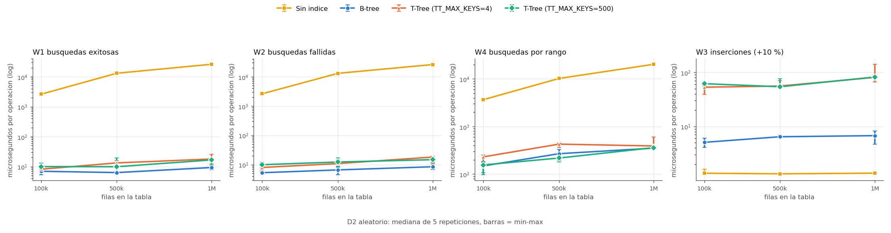
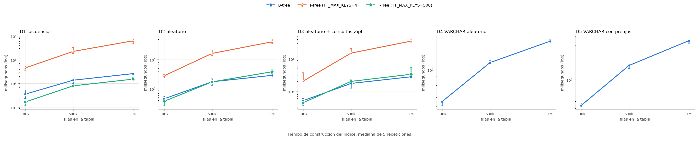
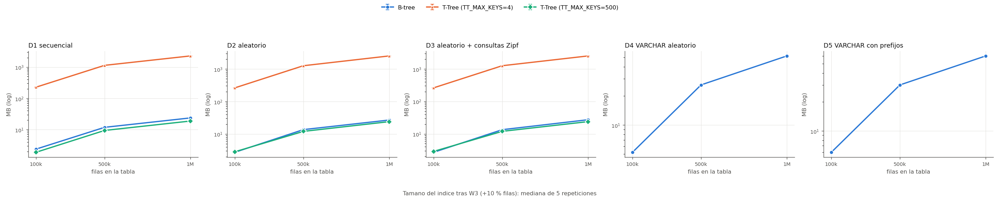

# Semana 6: evaluación de rendimiento

## Objetivo

Medir el T-Tree frente al acceso sin índice y al B-tree nativo de PostgreSQL con los mismos datos, las mismas consultas y las mismas condiciones. Se miden búsquedas exitosas, búsquedas fallidas, búsquedas por rango, inserciones, tiempo de construcción y tamaño del índice, en tres tamaños de tabla y con dos tamaños de nodo del T-Tree (`TT_MAX_KEYS=4` y `TT_MAX_KEYS=500`).

## Diseño experimental

### Datasets

Los genera `benchmarks/generators/generar_datos.py` con semillas fijas, en tamaños de 100 000, 500 000 y 1 000 000 de filas. Las claves son únicas.

| Dataset | Clave | Contenido |
|---|---|---|
| D1 | `int4` | Secuencial: 1, 2, …, N |
| D2 | `int4` | Aleatoria uniforme en [1, 2 147 483 646] |
| D3 | `int4` | Los mismos datos de D2, pero las consultas siguen una distribución Zipf (s = 1,1), con unas pocas claves muy consultadas |
| D4 | `varchar` | Cadenas aleatorias de 8 a 32 caracteres |
| D5 | `varchar` | Cadenas con 10 prefijos comunes (`arequipa-cayma-…`, `lima-surco-…`) y 10 caracteres aleatorios |

### Workloads

Los genera `benchmarks/workloads/generar_workloads.py` para cada dataset y tamaño.

| Workload | Operaciones | Detalle |
|---|---|---|
| W1 búsquedas exitosas | 10 000 | Claves presentes en la tabla |
| W2 búsquedas fallidas | 10 000 | Claves ausentes; en D1 vienen de [−N, 0] y (2N, 3N] |
| W3 inserciones | 10 % de N | Claves nuevas, que no estaban en la tabla |
| W4 búsquedas por rango | 1 000 | Intervalos que devuelven entre 10 y 1 000 filas |

Cada consulta es `SELECT count(*), sum(pay) FROM t WHERE k = $1` (o `BETWEEN` para W4). Las sumas de control permiten comprobar que los tres métodos devuelven lo mismo.

### Métodos y configuraciones

| Serie | Imagen |
|---|---|
| Sin índice | `TT_MAX_KEYS=4` (no depende del índice) |
| B-tree | Medido en las dos imágenes, `TT_MAX_KEYS=4` y `500` |
| T-Tree `TT_MAX_KEYS=4` | Imagen construida con `./scripts/reset.sh 4` |
| T-Tree `TT_MAX_KEYS=500` | Imagen construida con `./scripts/reset.sh 500` |

`TT_MAX_KEYS` es una constante de compilación, así que cada configuración usa una imagen distinta y sus resultados se guardan por separado (`benchmarks/results/tt4/` y `benchmarks/results/tt500/`). El runner comprueba, creando un índice de prueba y leyendo `ttree_dump`, que la extensión instalada tenga realmente el `TT_MAX_KEYS` indicado, y se detiene si no coincide. El T-Tree solo tiene clase de operadores para `int4`, por eso D4 y D5 se comparan solo entre sin índice y B-tree.

### Metodología de medición

- **Repeticiones:** 5 por combinación. Se reporta la mediana, con el coeficiente de variación y las barras mín–máx en los gráficos.
- **Aislamiento:** en cada repetición se recrea la tabla desde una copia base, se ejecuta `VACUUM ANALYZE` y `CHECKPOINT`, se construye el índice (tiempo de construcción) y se cargan tabla e índice en memoria con `pg_prewarm`. Así todas las mediciones se hacen con datos en `shared_buffers` (3 GB).
- **Tiempo en el servidor:** las operaciones se ejecutan en un bucle PL/pgSQL y se mide con `clock_timestamp()`. No se incluye la ida y vuelta cliente-servidor, que sería mayor que el tiempo de una búsqueda indexada.
- **Calentamiento:** 100 búsquedas de W1 descartadas antes de medir.
- **Planificador:** `max_parallel_workers_per_gather=0`, `jit=off`, `enable_bitmapscan=off` y `enable_indexonlyscan=off` en todos los métodos; con índice además `enable_seqscan=off`, para que siempre se mida el *index scan* del método evaluado. Los planes de la primera repetición se guardan en `planes.txt`.
- **Servidor:** `autovacuum=off`, `max_wal_size=8GB`, `checkpoint_timeout=30min`, `fsync=on` y `synchronous_commit=on`. W3 se ejecuta en una sola transacción.
- **Integridad:** después de W3 se ejecuta `ttree_check` sobre cada índice T-Tree. Si falla, se aborta la corrida.
- **Reproducibilidad:** los archivos de entrada se generan en el volumen `benchdata` y sus sumas SHA-256 quedan en `manifiesto_entradas.txt`. El entorno de cada corrida (versión, parámetros y commit) queda en `entorno_*.txt`.

## Archivos

| Archivo | Función |
|---|---|
| `benchmarks/generators/generar_datos.py` | D1, D2, D4 y D5 en CSV, con manifiesto SHA-256 |
| `benchmarks/workloads/generar_workloads.py` | W1–W4 por dataset y tamaño |
| `benchmarks/tools/Dockerfile` | Imagen de herramientas (`python:3.12.8-slim` y `matplotlib 3.9.2`) |
| `benchmarks/sql/bench.sql` | Esquema `bench` y funciones de medición |
| `benchmarks/sql/cargar.sql` | Carga de la tabla base y de los workloads |
| `benchmarks/sql/repeticion.sql` | Una repetición completa de un método |
| `benchmarks/runners/preparar_datos.sh` | Genera datasets y workloads en el volumen |
| `benchmarks/runners/run_bench.sh` | Corre las repeticiones y exporta los resultados |
| `benchmarks/runners/run_all.sh` | Todas las fases (`tt500`, `tt4`, `base_int` y `base_txt`) |
| `benchmarks/plots/analizar.py` | `resumen.md`, `resumen.csv`, comprobación de consistencia y gráficos |
| `benchmarks/results/tt4/`, `benchmarks/results/tt500/` | `resultados.csv`, `planes.txt`, `entorno_*.txt` y `manifiesto_entradas.txt` |

## Comandos

```bash
./scripts/reset.sh 500
./benchmarks/runners/preparar_datos.sh
TT_MAX_KEYS=500 METODOS="btree ttree" ./benchmarks/runners/run_bench.sh

./scripts/reset.sh 4
./benchmarks/runners/preparar_datos.sh
TT_MAX_KEYS=4 ./benchmarks/runners/run_bench.sh
TT_MAX_KEYS=4 METODOS="sin_indice btree" DATASETS="d4 d5" ./benchmarks/runners/run_bench.sh

docker compose --profile tools run --rm tools python benchmarks/plots/analizar.py
```

`./benchmarks/runners/run_all.sh` ejecuta todo en orden (unas 10 horas en el equipo de prueba, la mayor parte en el caso sin índice). `REP_INICIO` permite reanudar una serie desde una repetición concreta.

## Pruebas de validez

- **Mismos resultados en todos los métodos:** en las 45 combinaciones de dataset, tamaño y workload, el número de filas y la suma de control coinciden entre los métodos y entre las repeticiones (`analizar.py`: «45/45 sin diferencias»).
- **Integridad del T-Tree:** `ttree_check` dio OK en los 90 índices T-Tree después de las inserciones (45 con `TT_MAX_KEYS=4` y 45 con `500`).
- **Planes:** los 72 planes con índice de `tt4/planes.txt` y los 54 de `tt500/planes.txt` usan `Index Scan using t_idx`. Los 45 sin índice usan `Seq Scan`.

## Resultados

Mediana de 5 repeticiones. Búsquedas e inserciones en **microsegundos por operación**. Las tablas completas, con coeficiente de variación, están en `benchmarks/results/resumen.md`.

### Búsquedas puntuales (W1 exitosas, 1 000 000 de filas)

| Dataset | Sin índice | B-tree | T-Tree 4 | T-Tree 500 |
|---|---|---|---|---|
| D1 secuencial | 27 942 | 7,5 | 26,5 | 15,5 |
| D2 aleatorio | 26 099 | 9,3 | 17,8 | 16,6 |
| D3 Zipf | 26 187 | 8,0 | 13,3 | 16,4 |
| D4 VARCHAR | 30 459 | 4,5 | – | – |
| D5 VARCHAR con prefijos | 31 991 | 4,8 | – | – |

Las búsquedas fallidas (W2) tienen el mismo orden de magnitud: con D2 y 1M, 26 071 µs sin índice, 8,4 µs con B-tree, 18,0 µs con T-Tree 4 y 14,7 µs con T-Tree 500.



### Búsquedas por rango (W4, 1 000 000 de filas)

| Dataset | Sin índice | B-tree | T-Tree 4 | T-Tree 500 |
|---|---|---|---|---|
| D1 | 18 591 | 76 | 320 | 109 |
| D2 | 20 287 | 352 | 390 | 360 |
| D3 | 20 499 | 355 | 475 | 347 |

### Inserciones (W3, 10 % de N, microsegundos por fila)

| Dataset, 1M | Sin índice | B-tree | T-Tree 4 | T-Tree 500 |
|---|---|---|---|---|
| D1 | 1,4 | 4,3 | 48,3 | 72,6 |
| D2 | 1,4 | 6,7 | 80,7 | 82,0 |
| D3 | 1,4 | 6,8 | 73,8 | 81,3 |

### Construcción del índice (ms) y tamaño (MB), 1 000 000 de filas

| Dataset | B-tree | T-Tree 4 | T-Tree 500 | Tamaño B-tree | Tamaño T-Tree 4 | Tamaño T-Tree 500 |
|---|---|---|---|---|---|---|
| D1 | 248–261 | 6 307 | 153 | 21,4 | 1 953,1 | 15,6 |
| D2 | 289–319 | 4 100 | 383 | 21,4 | 1 953,1 | 15,6 |
| D3 | 279–314 | 3 516 | 332 | 21,4 | 1 953,1 | 15,6 |

El intervalo del B-tree corresponde a sus mediciones en las dos imágenes. Tras W3 (+10 % de filas), con D2: B-tree 26,8 MB, T-Tree 4 2 504,6 MB y T-Tree 500 23,8 MB.




### Páginas leídas por búsqueda (`EXPLAIN (ANALYZE, BUFFERS)`, D2 con 1M)

| Método | W1 (una clave) | W4 (rango de 722 filas) |
|---|---|---|
| Sin índice | 4 480 (toda la tabla) | 4 480 |
| B-tree | 4 | 727 |
| T-Tree 4 | 20 | 923 |
| T-Tree 500 | 12 | 735 |

## Análisis

**Índice frente a sin índice.** Sin índice, el costo de una búsqueda crece linealmente con N: unos 2,6 ms con 100k filas y 26–32 ms con 1M, porque siempre se recorre la tabla completa. Con B-tree o T-Tree la búsqueda cuesta entre 5 y 27 µs y casi no cambia con N. Es una diferencia de tres órdenes de magnitud. A cambio, sin índice la inserción es la más barata (1,4 µs por fila).

**T-Tree frente a B-tree en búsquedas.** El B-tree es más rápido en las búsquedas puntuales: con 1M de filas, entre 1,7 y 3,5 veces. La única excepción es D2 con 500k, donde el T-Tree de 500 quedó por delante (9,9 frente a 11,0 µs), dentro de un CV del 28 % al 35 %. La razón es la altura: en el B-tree con 1M de claves, una búsqueda lee 4 páginas en total, incluida la del *heap*, mientras que el T-Tree es un árbol binario balanceado y lee 12 páginas con nodos de 500 claves y 20 con nodos de 4, contando también la del *heap*. Todas las páginas están en memoria, así que la diferencia se debe al costo de fijar y bloquear cada *buffer* y de comparar en cada nodo, no a E/S de disco. En rangos, una vez encontrado el inicio, el T-Tree de 500 claves recorre nodos contiguos en orden y queda a la par del B-tree (D2: 360 frente a 352 µs). Con nodos de 4 claves paga una página por cada 4 claves (D1: 320 frente a 76 µs).

**Inserciones.** Es la debilidad principal del T-Tree implementado: 48–82 µs por fila frente a 4–7 µs del B-tree. El código explica la diferencia:
- `tt_insert_rec` desciende recursivamente y, a la vuelta, `tt_rebalance` reescribe con `tt_put_node` **cada nodo del camino** desde la raíz hasta el nodo modificado, aunque no haya cambiado. Cada escritura es un registro GenericXLog distinto, y también se reescribe la metapágina. Con 1M de claves son unos 11 nodos con `TT_MAX_KEYS=500` y unos 18 con `TT_MAX_KEYS=4`.
- El B-tree, en cambio, modifica y registra en WAL normalmente una sola hoja.
- Además, con 500 claves por nodo, insertar dentro de un nodo desplaza en promedio la mitad de sus entradas.

No se midió por separado cuánto aporta cada causa.

**Tamaño de nodo.** Con `TT_MAX_KEYS=4` cada nodo ocupa una página de 8 KB para 4 claves: el índice ocupa 1,95 GB para 1M de filas, 91 veces el B-tree, y su construcción tarda entre 3,5 y 6,3 s. Esto confirma que el T-Tree se diseñó para memoria principal, donde un nodo pequeño no cuesta una página entera. Con `TT_MAX_KEYS=500` el índice es más pequeño que el B-tree (15,6 frente a 21,4 MB), porque llena las páginas por completo. También se construye más rápido con datos secuenciales (153 frente a 248 ms en D1), pero no con datos aleatorios.

**Distribución de las claves.** `ttbuild` reúne todas las entradas, las ordena con `qsort` y arma un árbol balanceado de abajo hacia arriba (`tt_bulk`), escribiendo cada nodo una sola vez. En D1 las claves ya llegan ordenadas y la ordenación es casi gratuita, lo que explica la ventaja del T-Tree de 500 en construcción. Con D3 (Zipf) los tiempos son parecidos a los de D2. Como todos los datos están en memoria por `pg_prewarm`, concentrar las consultas en pocas claves no ahorra lecturas de disco.

**VARCHAR.** El B-tree sobre `varchar` (con *collation* C) busca en 4–5 µs, igual que sobre enteros. Los prefijos comunes de D5 aumentan el tamaño del índice (60 MB frente a 52 MB tras W3) pero no el tiempo. El T-Tree no tiene clase de operadores para `varchar`, por lo que no participa en esta comparación.

**Variabilidad.** Las búsquedas sin índice tienen un CV menor que 5 %. Las búsquedas indexadas sobre enteros, que miden unos pocos microsegundos, llegan a un CV del 40 %; sobre `varchar` se mantienen en general por debajo del 15 %. Por eso las diferencias menores que el doble entre B-tree y T-Tree en W4 no se consideran significativas.

## Limitaciones

- Una sola máquina (WSL 2, 8 CPU, 7,5 GiB) y todo en memoria. No se evaluó el comportamiento con datos que no caben en `shared_buffers`.
- Una sola sesión, sin concurrencia. El bloqueo de la metapágina del T-Tree serializa escritores y lectores, y eso no se refleja aquí.
- El T-Tree solo soporta `int4`. D4 y D5 no lo incluyen.
- **Versión del servidor.** Las mediciones de esta semana y de las semanas 8 y 9 se hicieron con un servidor **18.7**, no 18.6. En los Dockerfile, `apt-get install postgresql-server-dev-18` sin versión fija actualizaba el paquete del servidor de la imagen `postgres:18.6` a 18.7 (consta en `entorno_*.txt`). Se corrigió fijando el paquete a `${PG_VERSION}` y las pruebas funcionales se repitieron sobre 18.6. 18.7 es una versión menor de corrección de errores, sin cambios en la interfaz de Index AM ni en el planificador, pero los números no se volvieron a medir sobre 18.6.
- En la primera corrida, las repeticiones 4 y 5 de D1 con 500k filas sin índice se hicieron con el portátil en batería, y el ahorro de energía multiplicó por 13 el tiempo por búsqueda. Esas 7 filas se descartaron y las dos repeticiones se repitieron conectado a la corriente (`REP_INICIO=4`). Por eso hay varios archivos `entorno_*.txt` en `tt4/`.
