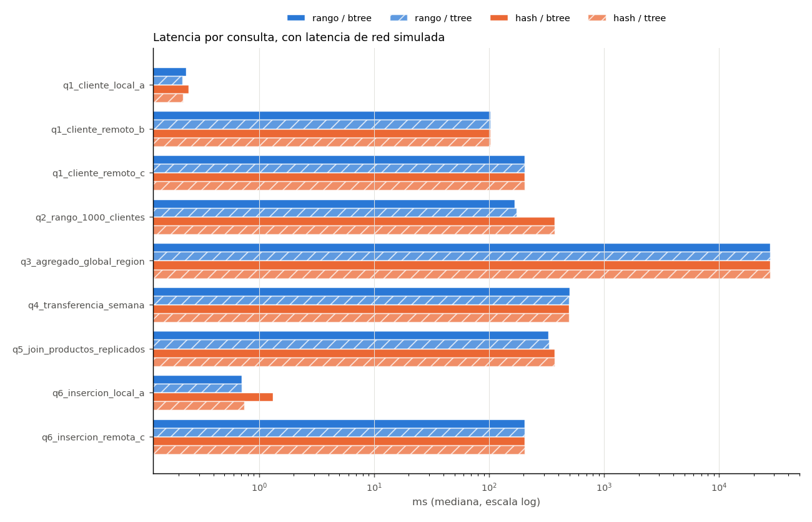
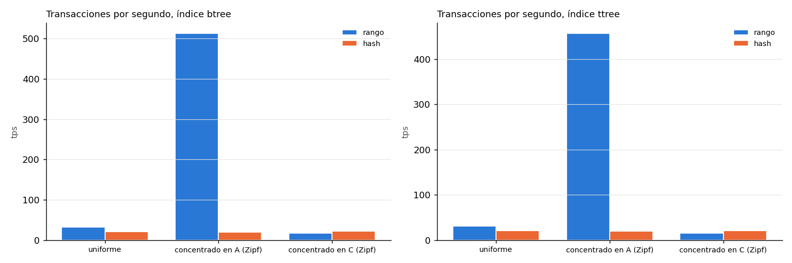
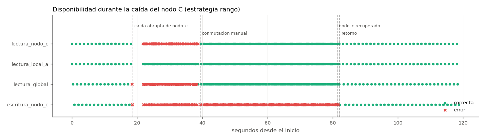

# Semana 9: experimentos distribuidos

## Objetivo

Comparar las dos estrategias de fragmentación (rango y hash) en igualdad de condiciones y medir:

- La latencia por consulta y la transferencia de datos.
- La diferencia entre consultas locales y multinodo.
- El efecto de las latencias de red y de la concentración de accesos.
- El comportamiento con carga mixta de lecturas y escrituras, la replicación y la caída de un nodo.
- La diferencia entre usar B-tree o T-Tree.

## Condiciones controladas

| Factor | Valor |
|---|---|
| Datos | Los mismos en ambas estrategias: 300 000 clientes, 1 000 000 de pedidos y 2 000 000 de líneas de detalle generados con semilla fija; solo cambia la ubicación de las filas |
| Hardware | Una máquina, 8 CPU, 7,5 GiB para Docker; tres contenedores PostgreSQL 18.6 |
| Coordinador | Todas las consultas se lanzan desde el nodo A |
| Índice sobre `id_cliente` | B-tree o T-Tree (`TT_MAX_KEYS=500`), reconstruido en los tres nodos y en las réplicas antes de cada serie |
| Latencia | Con latencia (RTT A–B 20 ms, A–C 40 ms, B–C 25 ms) o sin latencia (reglas `tc` eliminadas) |
| Planificador | `max_parallel_workers_per_gather=0`, `enable_partitionwise_join=on`, `enable_partitionwise_aggregate=on` |

## Métricas y metodología

- **Latencia por consulta** (`dist.medir`): tiempo de pared en A, incluido el *commit* de las transacciones remotas, porque cada repetición termina con `COMMIT`. Se hace una ejecución de calentamiento descartada y luego 20 repeticiones (5 para Q3, que dura unos 28 s). Se reporta la mediana, porque las colas por retransmisiones TCP o *checkpoints* son poco frecuentes pero grandes.
- **Transferencia de datos:** diferencia de los contadores reales de la interfaz de red de cada contenedor (`/sys/class/net/eth0/statistics/rx_bytes` y `tx_bytes`), antes y después de cada consulta o corrida. Son mediciones, no estimaciones, pero incluyen las cabeceras TCP/IP y del protocolo de PostgreSQL y cualquier otro tráfico simultáneo del nodo, como la replicación lógica.
- **Número de operaciones:** filas devueltas por consulta y transacciones por tipo en pgbench.
- **Carga mixta:** pgbench con 4 clientes en A durante 60 s, semilla fija (`--random-seed=20261120`), una corrida por configuración. Mezcla: 35 % pedidos de un cliente, 35 % pedidos de 100 clientes contiguos y 30 % inserción de pedido con su detalle. La proporción real de escrituras fue de 30,2 % a 31,6 %.
- **Concentración de accesos:** uniforme sobre los 300 000 clientes; Zipf(s = 1,1) concentrado en los primeros clientes (región de A); y el mismo Zipf concentrado en los últimos clientes (región de C).
- **Replicación:** `pg_stat_replication.replay_lag` muestreado cada segundo durante pgbench.
- **Caída de nodo:** sonda de cuatro operaciones cada 0,2 s, descrita en la semana 8.

## Comandos

```bash
cd distributed
./scripts/experimentos.sh       # consultas (2 índices × 2 latencias × 2 estrategias) y pgbench (2 × 2 × 3 modos)
./scripts/caida_nodo.sh rango
./scripts/caida_nodo.sh hash
./scripts/analizar.sh           # genera results/resumen.md, los CSV de resumen y results/graficos/
```

## Resultados

### Latencia por consulta (mediana en ms) y bytes recibidos por A

| Consulta | Nodos que toca (rango / hash) | Rango, con latencia | Hash, con latencia | Rango, sin latencia | Hash, sin latencia | Bytes recibidos por A (rango / hash) |
|---|---|---|---|---|---|---|
| Q1 cliente local en A | 1 / 1 | 0,23 | 0,24 | 0,23 | 0,27 | 0 / 0 |
| Q1 cliente en B | 1 / 1 | 102,5 | 102,2 | 0,63 | 0,71 | 940 / 1 237 |
| Q1 cliente en C | 1 / 1 | 203,1 | 203,5 | 0,64 | 0,62 | 1 480 / 999 |
| Q2 1 000 clientes contiguos | 1 / 3 | **166,6** | **371,8** | 3,06 | 4,34 | 61 077 / 40 662 |
| Q3 total por región (todo) | 3 / 3 | 27 974 | 27 794 | 530 | 567 | 24,5 MB / 23,9 MB |
| Q4 pedidos de una semana (10 006 filas) | 3 / 3 | 500,2 | 497,7 | 9,5 | 9,8 | 424 KB / 423 KB |
| Q5 detalle de 500 clientes con productos | 1 / 3 | 330,2 | 371,3 | 3,96 | 4,82 | 104 KB / 71 KB |
| Q6 inserción, cliente de A | 1 / 1 | 0,70 | 1,32 | 1,43 | 1,71 | 0 / 0 |
| Q6 inserción, cliente de C | 1 / 1 | 203,7 | 204,8 | 1,42 | 1,39 | 1 469 / 1 467 |

Índice B-tree. Con T-Tree, los valores con latencia difieren en un 4 % o menos, salvo Q6 local con hash (0,74 frente a 1,32 ms, una diferencia de décimas de milisegundo). Las cifras completas están en `distributed/results/resumen.md`.



### Carga mixta 70/30 (transacciones por segundo, 0 transacciones fallidas en todas las corridas)

| Acceso | Rango B-tree | Rango T-Tree | Hash B-tree | Hash T-Tree |
|---|---|---|---|---|
| Uniforme | 32,1 | 30,7 | 20,7 | 20,6 |
| Concentrado en A (local) | **512,8** | **457,0** | 19,9 | 20,4 |
| Concentrado en C (40 ms) | 16,8 | 16,0 | 22,2 | 21,6 |

Mediana de latencia por transacción con B-tree:

| Estrategia | Lectura de un cliente | Lectura de 100 clientes | Escritura |
|---|---|---|---|
| Rango, acceso uniforme | 102 ms | 103 ms | 166 ms |
| Hash, acceso uniforme | 102 ms | 305 ms | 165 ms |
| Rango, concentrado en A | 0,2 ms | 0,5 ms | 1,5 ms |

Tráfico de red total por transacción, sumado en los tres nodos: entre 5,4 y 7,7 KB con accesos remotos, y 1,4 KB con la carga concentrada en A, donde casi no hay consultas remotas y el tráfico es principalmente de replicación.



### Replicación

Con la carga mixta, la mediana de `replay_lag` es igual al RTT del enlace correspondiente:

| Enlace | Mediana de `replay_lag` |
|---|---|
| A→B | 20,3 ms |
| B→C | 25,3 ms |
| C→A | 40,3 ms |

El p95 se mantiene cerca de la mediana, salvo en la suscripción `sub_frag_b` durante la carga por rangos: p95 de 225 ms y máximo de 427 ms. El máximo observado en todas las suscripciones fue de 427 ms.

### Caída del nodo C

Ver la semana 8 y los gráficos `caida_rango.png` y `caida_hash.png`. Ninguna lectura local en A falló. Las consultas que dependen de C fallaron solo entre la caída y la conmutación manual. Las réplicas quedaron consistentes tras la recuperación (9 de 9 pares en cada estrategia).



## Análisis

**Cuándo conviene cada estrategia.**
- La fragmentación por rango conviene cuando las consultas siguen la localidad de la clave: intervalos de clientes (Q2: 167 frente a 372 ms) o clientes de la región del coordinador. Con accesos concentrados en A alcanza 513 tps, 25 veces lo que logra hash.
- Su debilidad es el punto caliente: si los accesos se concentran en el nodo más lejano (C), cae a 17 tps, por debajo de hash.
- Hash da un rendimiento estable (20–22 tps) frente a cualquier concentración de accesos, pero convierte toda consulta por intervalo en una consulta a los tres nodos.

**Qué operaciones generan más transferencia.**
- Las que deben traer filas al coordinador: el agregado global Q3 transfiere 24 MB, porque `postgres_fdw` en PostgreSQL 18 no empuja la agregación parcial al nodo remoto, y Q4 transfiere 424 KB.
- Las búsquedas de un cliente transfieren 1–1,5 KB, la mayor parte del protocolo de la transacción remota.
- En Q2, hash transfiere menos bytes que rango (40 KB frente a 61 KB) aunque tarda más: recibe tres agregados pequeños en vez de las filas de un solo nodo, pero paga tres viajes de red.

**Qué domina el tiempo.**
- El número de idas y vueltas, no el volumen. Una consulta remota simple cuesta unas 5 idas y vueltas (102 ms con 20 ms de RTT).
- Sin latencia, las mismas consultas tardan entre 0,6 y 10 ms, y el agregado global 0,53 s en vez de 28 s.

**Replicación.**
- No añade latencia a las escrituras porque es asíncrona: una inserción local cuesta 0,7 ms.
- A cambio, la réplica va detrás del primario en aproximadamente un RTT.
- Permitió mantener la lectura del fragmento de C durante su caída, tras la conmutación manual.

**B-tree frente a T-Tree.**
- Con latencia de red, la diferencia entre índices casi desaparece (menos del 1 % en Q1; en pgbench con acceso uniforme, 4 % en rango y 0,5 % en hash, dentro de la variación de una sola corrida), porque una búsqueda indexada local cuesta microsegundos frente a decenas de milisegundos de red.
- Solo cuando el trabajo es local se nota la ventaja del B-tree:
  - Carga concentrada en A: 513 frente a 457 tps.
  - p95 de la lectura de 100 clientes: 1,5 frente a 13,5 ms.
  - Q2 sin latencia: 3,1 frente a 10,6 ms.
- El T-Tree recorre un árbol binario con más saltos de página, materializa todos los TID del rango antes de devolverlos y serializa escritores y lectores con el bloqueo de la metapágina. Con `TT_MAX_KEYS=500` es usable en el escenario distribuido, pero no aporta ventaja sobre B-tree.

## Limitaciones

- Una sola corrida de 60 s por configuración de pgbench. Las diferencias de menos del 5 % entre índices con latencia no son significativas.
- Los tres nodos comparten CPU, memoria y disco, y el ancho de banda no está limitado.
- Los bytes medidos son de la interfaz completa del contenedor e incluyen el tráfico de replicación simultáneo.
- Coordinador único (A). No se midieron clientes conectados a B o C.
- Los datos crecen ligeramente durante los experimentos, por las inserciones de Q6 y de pgbench (unos miles de filas sobre un millón).
- El cliente elegido como «remoto en B» en la estrategia rango (id 100001) no tiene pedidos: Q1 mide el costo de la ida y vuelta con 0 filas.
- Los experimentos se ejecutaron sobre PostgreSQL 18.7 (ver las limitaciones de la semana 8). Es una versión menor de corrección de errores; los experimentos no se repitieron sobre 18.6.
