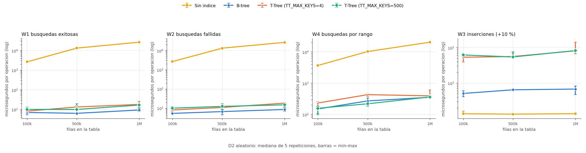
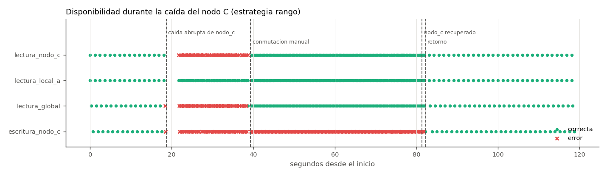

# T-Tree como Index Access Method de PostgreSQL 18.6: evaluación local y distribuida

Bases de Datos II · Universidad Católica San Pablo · Grupo 4

## 1. Introducción

Un índice permite encontrar filas sin recorrer toda la tabla. PostgreSQL incluye varios métodos de acceso (B-tree, hash, GiST, GIN, BRIN) y permite agregar nuevos como extensiones mediante la interfaz de *Index Access Methods*. En este proyecto se implementó un **T-Tree**, una estructura propuesta para bases de datos en memoria principal, como método de acceso nativo (`CREATE INDEX ... USING ttree`).

El proyecto tiene dos etapas:

1. **Etapa I (semanas 1–5):** prototipo en Python, implementación en C del T-Tree con páginas, *buffers* y WAL de PostgreSQL, e integración con el planificador. En la semana 6 se auditó y se corrigieron tres errores.
2. **Etapa II (semanas 6–10):**
   - Una evaluación de rendimiento del T-Tree frente al acceso sin índice y al B-tree nativo.
   - Un sistema distribuido de tres nodos con dos estrategias de fragmentación, latencias simuladas, replicación lógica y una prueba de caída de nodo. En él se compararon el B-tree y el T-Tree como índices locales de cada fragmento.

Todos los resultados de este informe se midieron en el repositorio. Los datos crudos están en `benchmarks/results/` y `distributed/results/`.

## 2. Fundamentos del T-Tree

El T-Tree (Lehman y Carey, 1986) es un árbol binario de búsqueda balanceado (AVL) en el que cada nodo guarda un **arreglo ordenado de claves**, no una sola. Cada nodo cubre el intervalo entre su clave mínima y su clave máxima:

- **Búsqueda:** se compara la clave con el mínimo y el máximo del nodo. Si es menor, se baja por la izquierda; si es mayor, por la derecha; si está dentro del intervalo, se busca dentro del arreglo del nodo.
- **Inserción:** se ubica el nodo que acota la clave y se inserta en su arreglo. Si el nodo está lleno, se desplaza una clave extrema hacia el subárbol correspondiente. Si se crea un nodo nuevo, se rebalancea con rotaciones AVL simples o dobles.
- **Rangos:** se localiza el inicio del rango y se recorre el árbol en orden.

Se diseñó para memoria principal: el costo dominante es comparar claves, no leer bloques. Guardar varias claves por nodo reduce el número de nodos y punteros respecto de un AVL clásico.

## 3. Comparación conceptual con el B-tree

| Aspecto | T-Tree | B-tree (PostgreSQL) |
|---|---|---|
| Forma | Binario (2 hijos por nodo), balanceado por altura | Multivía (cientos de hijos por página) |
| Altura con N claves y k claves por nodo | ≈ log2(N/k) | ≈ log_f(N), con f de cientos |
| Pensado para | Memoria principal | Disco (minimizar bloques leídos) |
| Rebalanceo | Rotaciones AVL que afectan a varios nodos | División y fusión locales de páginas |
| Rangos | Recorrido en orden del árbol | Hojas enlazadas |
| Concurrencia en PostgreSQL | Esta implementación: escritores serializados por la metapágina | Bloqueo por página (Lehman–Yao) |

En disco, donde cada nodo ocupa una página de 8 KB, el factor de ramificación favorece al B-tree. Una búsqueda en un B-tree de 1M de claves lee pocas páginas; en un T-Tree lee unas log2(N/k), es decir, 11 con k = 500 y 18 con k = 4. La hipótesis de la evaluación era que el T-Tree **no** superaría al B-tree en búsquedas puntuales dentro de PostgreSQL, y que su comportamiento dependería mucho de k.

## 4. Diseño e implementación

### 4.1 Prototipo (semanas 2–3)

`python/` contiene un prototipo del T-Tree sobre un simulador de disco basado en el repositorio `ekials/Simulaci-n-Disco`, que se usó para validar la lógica de inserción, rotaciones y búsqueda antes de pasar a C.

### 4.2 Representación en páginas (`src/ttree.c`)

- **Bloque 0, metapágina** (`TtMeta`): número mágico, bloque raíz, número de entradas y de nodos.
- **Un nodo por página** (`TtNode`): `nkeys`, altura, bloques hijo izquierdo y derecho, y un arreglo de `TT_MAX_KEYS` entradas `(clave int4, TID)`. `TT_MAX_KEYS` es una constante de compilación: un `StaticAssertDecl` garantiza que el nodo cabe en una página. Con 500 claves, un nodo ocupa unos 5 KB.
- **Acceso:** `tt_get_node` lee el nodo con bloqueo compartido y valida `nkeys`; `tt_put_node` lo escribe con bloqueo exclusivo y lo registra en WAL con **GenericXLog**.
- **Inserción** (`tt_insert_key` → `tt_insert_rec` → `tt_rebalance` y `tt_rot_left/right`): bloqueo exclusivo de la metapágina, descenso recursivo e inserción en el nodo que acota la clave. Si el nodo está lleno, la clave extrema se desplaza a un hijo. A la vuelta de la recursión se recalculan las alturas y se rota si el desbalance es mayor que 1.
- **Construcción** (`ttbuild` → `tt_bulk`): lee la tabla, ordena las entradas con `qsort` y construye un árbol perfectamente balanceado de abajo hacia arriba, escribiendo cada nodo una sola vez.
- **Escaneo** (`tt_scan_prepare` → `tt_range_rec`): traduce las condiciones (`<`, `<=`, `=`, `>=`, `>`) a un intervalo `[lo, hi]`, recorre en orden los subárboles que se solapan con él y reúne los TID en un arreglo. `ttgettuple` los devuelve uno a uno.
- **VACUUM** (`ttbulkdelete`): marca como borradas (*tombstones*) las entradas cuyos TID ya no existen.
- **Inspección:** `ttree_check` (orden, intervalos, alturas, balanceo AVL y conteo), `ttree_dump` y `ttree_lookup`.

### 4.3 Correcciones de la auditoría (semana 6)

Detalle completo en `docs/semana_01_05/auditoria.md`.

| Problema | Corrección | Prueba |
|---|---|---|
| P1 `amoptionalkey = true` en un AM que no indexa NULL: error en *index-only scan* con un índice parcial y riesgo de omitir filas | `amoptionalkey = false` | R1 |
| P2 `ttbulkdelete` sumaba el conteo de entradas en cada pasada de VACUUM (`reltuples` de 8,25M con 150 000 filas) | Reiniciar `num_index_tuples` en cada pasada | R2 |
| P3 El escaneo no informaba sus búsquedas (`idx_scan = 0`, `Index Searches: 0`) | `pgstat_count_index_scan` y `nsearches++` | R5 |

No se reescribió ninguna función del T-Tree: las tres correcciones son de una o dos líneas.

## 5. Integración con PostgreSQL

- **Extensión** (`sql/ttree--1.0.sql`, `ttree.control`): `CREATE ACCESS METHOD ttree TYPE INDEX HANDLER tthandler`, la clase de operadores `int4_ops` con los cinco operadores de comparación y la función de soporte `btint4cmp`, y las funciones de inspección.
- **`tthandler`** devuelve un `IndexAmRoutine` con `ambuild`, `ambuildempty`, `aminsert`, `ambulkdelete`, `amvacuumcleanup`, `amcostestimate` (con `genericcostestimate`), `amvalidate`, `ambeginscan`, `amrescan`, `amgettuple` y `amendscan`. Declara `amstrategies = 5`, `amsupport = 1` y `amoptionalkey = false`. Los demás indicadores (`amcanorder`, `amcanunique`, `amcanmulticol`, `amsearchnulls` y otros) quedan en `false` porque `makeNode` inicializa la estructura en cero, y `amgetbitmap` es `NULL`.
- **WAL y recuperación:** cada página se registra con GenericXLog, por lo que el índice se recupera tras una caída. `tests/integration/reinicio.sh` lo comprueba con un `SIGKILL`.
- **Planificador:** el índice aparece como `Index Scan using ... ` con `Index Cond` y `Index Searches: 1` en `EXPLAIN (ANALYZE, BUFFERS)`.
- **Compilación:** PGXS (`Makefile`), dentro de una imagen `postgres:18.6`. Durante la validación final se detectó que `apt-get install postgresql-server-dev-18` sin versión fija actualizaba el servidor de la imagen a 18.7. Se corrigió fijando el paquete a `${PG_VERSION}` (ver la sección 13).

**Pruebas funcionales** (todas pasan sobre 18.6, con `TT_MAX_KEYS` = 4 y 500):

| Suite | Contenido |
|---|---|
| `tests/validar_tid.sql` | Construcción, inserciones ascendentes y descendentes, borrado y VACUUM, NULL y REINDEX |
| `tests/test_scan.sql` | 615 consultas con todos los operadores, comparadas con el resultado del *heap* |
| `tests/regression/regresion_am.sql` | R1–R5: índice parcial con NULL, VACUUM en varias pasadas, extremos de int4, *rollback*, TRUNCATE, CREATE INDEX CONCURRENTLY y uso del índice |
| `tests/integration/reinicio.sh` | Reinicio ordenado y caída abrupta, con recuperación por WAL |

## 6. Metodología experimental (benchmark local)

Detalle en `docs/semana_06/README.md`.

- **Datos:** D1 enteros secuenciales, D2 enteros aleatorios, D3 = D2 con consultas Zipf (s = 1,1), D4 VARCHAR aleatorio y D5 VARCHAR con prefijos comunes. Tamaños de 100 000, 500 000 y 1 000 000 de filas. Se generan con semillas fijas y se verifican con SHA-256.
- **Workloads:**
  - W1: 10 000 búsquedas exitosas.
  - W2: 10 000 búsquedas fallidas.
  - W3: inserciones del 10 % de N.
  - W4: 1 000 rangos de 10 a 1 000 filas.
- **Métodos:** sin índice, B-tree y T-Tree con `TT_MAX_KEYS` 4 y 500. Cada valor de `TT_MAX_KEYS` usa su propia imagen y sus resultados se guardan por separado; el runner verifica el valor real con `ttree_dump`.
- **Medición:**
  - 5 repeticiones por combinación, con la tabla recreada, el índice reconstruido y los datos precargados en memoria.
  - Tiempo medido en el servidor con `clock_timestamp()` dentro de un bucle PL/pgSQL.
  - Sin paralelismo ni JIT, y con el método de acceso forzado.
  - Se reporta la mediana y el coeficiente de variación.
- **Validez:** las 45 combinaciones devuelven las mismas filas y sumas de control en todos los métodos, y `ttree_check` da OK en los 90 índices T-Tree después de W3.
- **Entorno:** Windows 11 con WSL 2, 8 CPU y 7,5 GiB para Docker; `shared_buffers=3GB`. Las mediciones se hicieron sobre el servidor 18.7, como se explica en la sección 13.

## 7. Resultados del benchmark

Mediana en microsegundos por operación, con 1 000 000 de filas. Las tablas completas para los tres tamaños están en `benchmarks/results/resumen.md`.

| Workload (D2 aleatorio) | Sin índice | B-tree | T-Tree 4 | T-Tree 500 |
|---|---|---|---|---|
| W1 búsqueda exitosa | 26 099 | 9,3 | 17,8 | 16,6 |
| W2 búsqueda fallida | 26 071 | 8,4 | 18,0 | 14,7 |
| W4 rango (10–1 000 filas) | 20 287 | 352 | 390 | 360 |
| W3 inserción | 1,4 | 6,7 | 80,7 | 82,0 |

| Índice, 1M filas | B-tree | T-Tree 4 | T-Tree 500 |
|---|---|---|---|
| Construcción D1 secuencial (ms) | 248–261 | 6 307 | 153 |
| Construcción D2 aleatorio (ms) | 289–319 | 4 100 | 383 |
| Tamaño tras construir (MB) | 21,4 | 1 953,1 | 15,6 |
| Tamaño tras W3 (MB, D2) | 26,8 | 2 504,6 | 23,8 |
| Páginas leídas por búsqueda puntual (D2) | 4 | 20 | 12 |

VARCHAR (solo sin índice y B-tree, porque el T-Tree solo soporta `int4`): con 1M de filas, la búsqueda exitosa cuesta 30 459 µs sin índice y 4,5 µs con B-tree en D4, y 31 991 frente a 4,8 µs en D5.

Hallazgos:

1. **Cualquier índice frente a sin índice:** la búsqueda baja de decenas de milisegundos, con un costo que crece linealmente con N, a unos pocos microsegundos casi constantes. Son unas 3 000 veces menos con 1M de filas.
2. **Búsquedas puntuales:** el B-tree es entre 1,7 y 3,5 veces más rápido que el T-Tree con 1M de filas, por la menor altura: lee 4 páginas frente a 12 o 20.
3. **Rangos:** con 500 claves por nodo, el T-Tree empata con el B-tree. Con 4 claves es hasta 4 veces más lento en D1, porque lee una página por cada 4 claves.
4. **Inserciones:** son la gran debilidad del T-Tree implementado, entre 10 y 15 veces más lentas que el B-tree. Cada inserción reescribe y registra en WAL todos los nodos del camino hasta la raíz.
5. **Tamaño de nodo:** con k = 4 el índice ocupa 91 veces lo que el B-tree, porque un nodo de 4 claves usa una página de 8 KB. Con k = 500 ocupa un 27 % menos que el B-tree y se construye más rápido con datos ordenados.

## 8. Diseño distribuido

Detalle en `docs/semana_07/README.md`.

Se modeló una tienda con cuatro tablas: `clientes` (300 000 filas), `productos` (5 000), `pedidos` (**1 000 000**, la relación principal) y `detalle` (unos 2 000 000). Hay tres nodos PostgreSQL 18 (A, B y C) en contenedores Docker con red propia, y el nodo A actúa como coordinador de las consultas.

## 9. Fragmentación

La clave de fragmentación es `id_cliente`, por cuatro razones:

1. Las consultas típicas son por cliente.
2. Deja cada pedido y su detalle en el nodo de su cliente (fragmentación derivada), así que las claves foráneas `pedidos → clientes` y `detalle → pedidos` se validan localmente.
3. Es `int4`, el tipo que soporta el T-Tree.
4. Admite tanto rango como hash.

| Estrategia | A | B | C |
|---|---|---|---|
| Rango | `1 ≤ id < 100 001` (región sur) | `100 001 ≤ id < 200 001` (centro) | `200 001 ≤ id < 300 001` (oriente) |
| Hash | `hash(id) mod 3 = 0` | `= 1` | `= 2` |

Los mismos datos se cargan en las dos estrategias, en esquemas separados. `06_verificar.sql` comprueba la completitud, la disyunción, la reconstrucción (`EXCEPT ALL` vacío), el predicado de cada fragmento y la fragmentación derivada, con resultado `VERIFICACION OK`. Reparto de `pedidos` con rango: 334 256 / 331 767 / 333 977; con hash: 334 796 / 332 827 / 332 377.

Las consultas globales usan **particionamiento declarativo con `postgres_fdw`**:
- Cada nodo tiene tablas `g_rango.*` y `g_hash.*` particionadas, con una partición local y dos foráneas.
- El planificador descarta las particiones que no aplican (*partition pruning*) y envía filtros y *joins* a los nodos remotos.

## 10. Asignación

| Nodo | Fragmentos primarios | Réplicas que aloja | `productos` |
|---|---|---|---|
| A | `*_a` de ambas estrategias | `*_c` | Origen |
| B | `*_b` | `*_a` | Réplica |
| C | `*_c` | `*_b` | Réplica |

Las escrituras van siempre al primario. `productos` es pequeña y casi de solo lectura, así que se replica completa en los tres nodos para validar `detalle → productos` y resolver los *joins* localmente.

## 11. Replicación

- **Mecanismo:** replicación lógica nativa, continua y asíncrona. `pub_ref` lleva `productos` de A a B y C, y `pub_frag_x` / `sub_frag_x` replican cada fragmento al nodo siguiente (A→B, B→C, C→A).
- **Réplicas de solo lectura:** un *trigger* rechaza las escrituras de sesiones normales.
- **Conmutación manual:** `dist.conmutar` reemplaza en el coordinador A las particiones foráneas del nodo caído por su réplica local (solo lectura) y permite el regreso. No hay detección automática de fallos ni elección de un nuevo primario.
- **Latencias:** se simulan con `tc` (`prio` + `netem` con filtro por IP de destino). Cada par tiene su propio RTT: A–B 20 ms, A–C 40 ms y B–C 25 ms, con la mitad del retardo en cada extremo. Con ping se midieron 20,4–20,7, 40,5–40,7 y 25,5–25,7 ms.

## 12. Resultados distribuidos

Detalle en `docs/semana_08/README.md`, `docs/semana_09/README.md` y `distributed/results/resumen.md`. Coordinador A, índice B-tree; mediana de 20 repeticiones (5 para Q3).

| Consulta | Rango, con latencia | Hash, con latencia | Rango, sin latencia | Hash, sin latencia |
|---|---|---|---|---|
| Q1 cliente local en A | 0,23 ms | 0,24 ms | 0,23 ms | 0,27 ms |
| Q1 cliente en C | 203 ms | 204 ms | 0,64 ms | 0,62 ms |
| Q2 1 000 clientes contiguos | **167 ms** (1 nodo) | **372 ms** (3 nodos) | 3,1 ms | 4,3 ms |
| Q3 total por región | 28,0 s (24,5 MB) | 27,8 s (23,9 MB) | 0,53 s | 0,57 s |
| Q4 pedidos de una semana | 500 ms | 498 ms | 9,5 ms | 9,8 ms |
| Q6 inserción, cliente de C | 204 ms | 205 ms | 1,4 ms | 1,4 ms |

Carga mixta 70/30 con pgbench (4 clientes, 60 s, 0 transacciones fallidas), en transacciones por segundo:

| Acceso | Rango B-tree | Rango T-Tree | Hash B-tree | Hash T-Tree |
|---|---|---|---|---|
| Uniforme | 32,1 | 30,7 | 20,7 | 20,6 |
| Concentrado en A | **512,8** | **457,0** | 19,9 | 20,4 |
| Concentrado en C | 16,8 | 16,0 | 22,2 | 21,6 |

- **Replicación:** la mediana de `replay_lag` es igual al RTT de cada enlace (20,3, 25,3 y 40,3 ms). El máximo observado fue 427 ms.
- **Caída de C** (`SIGKILL`):
  - Las lecturas locales en A no fallaron en ningún momento.
  - Las operaciones que dependen de C fallaron solo entre la caída y la conmutación manual. Después, la lectura del fragmento de C se sirvió desde la réplica local y la escritura quedó rechazada (solo lectura).
  - Tras la recuperación por WAL, las suscripciones se reanudaron solas y los 9 pares primario/réplica volvieron a coincidir en las dos estrategias.

## 13. Discusión

- **¿Cuándo conviene el T-Tree dentro de PostgreSQL?** Casi nunca frente al B-tree nativo:
  - PostgreSQL guarda los índices en páginas de 8 KB, y en ese modelo gana la estructura de mayor ramificación.
  - El T-Tree con nodos grandes (500 claves) se acerca al B-tree en búsquedas y rangos, ocupa menos y se construye rápido, pero pierde claramente en inserciones.
  - Con nodos pequeños, como en el diseño original para memoria, desperdicia páginas y su tamaño se vuelve inviable.
  - El resultado confirma que la ventaja del T-Tree depende de un modelo de memoria que no es el de un SGBD con *buffer pool* paginado.
- **Implementación frente a estructura:** parte de la desventaja en inserciones se debe a decisiones de esta implementación: reescribir todo el camino en cada inserción, un registro WAL por página y bloqueo exclusivo de la metapágina. Por eso no es inherente al T-Tree. Escribir solo los nodos que cambian reduciría ese costo.
- **Distribuido:**
  - El tiempo de las consultas remotas lo dominan las idas y vueltas de red (unas 5 por consulta remota simple), no el índice. Con latencia, B-tree y T-Tree difieren en un 4 % o menos.
  - La fragmentación por rango gana cuando el acceso respeta la localidad (intervalos de clientes y carga regional). Hash ofrece un rendimiento estable ante accesos concentrados, pero convierte toda consulta por intervalo en una consulta a los tres nodos.
  - `postgres_fdw` en PostgreSQL 18 no envía la agregación parcial al nodo remoto, y por eso el total global transfiere 24 MB.
- **Versión del servidor:**
  - Durante la validación final se detectó que las mediciones del benchmark y de los experimentos distribuidos se ejecutaron sobre PostgreSQL **18.7**. El Dockerfile partía de `postgres:18.6`, pero instalar `postgresql-server-dev-18` sin fijar la versión actualizaba también el servidor.
  - Se corrigió fijando la versión, y todas las pruebas funcionales y la puesta en marcha distribuida se repitieron sobre 18.6.
  - 18.7 es una versión menor de corrección de errores, sin cambios en la interfaz de Index AM ni en el planificador, por lo que no se esperan diferencias en las conclusiones. Aun así, las mediciones no se repitieron sobre 18.6, y se declara.

## 14. Limitaciones

- El T-Tree solo soporta `int4`, sin UNIQUE, multicolumna, *index-only scan*, *bitmap scan*, ORDER BY por el índice ni tablas UNLOGGED.
- Una inserción con rotación escribe varias páginas en registros WAL separados, por lo que no es atómica ante una caída en mitad de la operación. `ttree_check` detecta el daño y `REINDEX` lo repara.
- Escritores serializados por la metapágina; escaneo materializado en memoria; *tombstones* sin reciclar; `genericcostestimate` no modela la altura del árbol.
- El benchmark se hizo en una sola máquina, sin concurrencia y con todos los datos en memoria.
- El escenario distribuido corre en un solo equipo físico: la latencia es simulada y el ancho de banda no está limitado.
  - Solo hay un coordinador (A) y la conmutación es manual.
  - No hay *commit* en dos fases entre nodos.
  - Se hizo una sola corrida de pgbench por configuración.
- Las mediciones se hicieron con PostgreSQL 18.7 (sección 13).

## 15. Conclusiones

1. Se implementó un T-Tree completo como Index Access Method de PostgreSQL 18, con construcción, inserción con rotaciones AVL, escaneo por rangos, VACUUM, WAL y funciones de verificación. Pasa todas las pruebas funcionales y se recupera de una caída abrupta.
2. La auditoría encontró y corrigió tres errores reales: uno de corrección de resultados (`amoptionalkey`), uno de estadísticas (VACUUM) y uno de observabilidad.
3. Frente al acceso secuencial, el T-Tree reduce el tiempo de búsqueda en tres órdenes de magnitud. Frente al B-tree es entre 1,7 y 3,5 veces más lento en búsquedas puntuales, empata en rangos con nodos grandes y es entre 10 y 15 veces más lento en inserciones.
4. El tamaño del nodo es decisivo: con 4 claves por nodo el índice es inviable en disco (1,95 GB frente a 21 MB); con 500 claves es competitivo en lectura y más pequeño que el B-tree.
5. En el sistema distribuido, la ubicación de los datos y la latencia de red pesan mucho más que la estructura del índice. La fragmentación por rango es la mejor opción para cargas con localidad y hash para cargas sin patrón, y la replicación lógica permitió mantener las lecturas durante la caída de un nodo.

## 16. Referencias

1. T. J. Lehman y M. J. Carey, «A Study of Index Structures for Main Memory Database Management Systems», *Proc. 12th VLDB Conference*, 1986, pp. 294–303.
2. PostgreSQL Global Development Group, *PostgreSQL 18 Documentation*: «Index Access Method Interface Definition», «Generic WAL Records», «postgres_fdw», «Logical Replication», «Table Partitioning» y «pgbench». https://www.postgresql.org/docs/18/
3. Código fuente de PostgreSQL 18, `contrib/bloom` (referencia de la estructura mínima de un Index AM con GenericXLog) y `src/backend/access/nbtree` (comparación con `btvacuumscan`).
4. R. Bayer y E. McCreight, «Organization and Maintenance of Large Ordered Indexes», *Acta Informatica* 1(3), 1972.
5. M. T. Özsu y P. Valduriez, *Principles of Distributed Database Systems*, 4.ª ed., Springer, 2020 (fragmentación, asignación y replicación).
6. Linux `tc-netem(8)`: simulación de retardo de red.
7. Repositorio `ekials/Simulaci-n-Disco`: base del prototipo en Python.

**Herramientas y código externo:**
- Imágenes Docker oficiales `postgres:18.6` y `python:3.12.8-slim`, y biblioteca `matplotlib` 3.9.2 para los gráficos.
- La lógica del T-Tree, los scripts y el SQL son del grupo; `contrib/bloom` se usó como guía de la interfaz.
- Se usaron asistentes de IA como apoyo en la implementación, las pruebas y la redacción. Todos los resultados reportados provienen de ejecuciones reales registradas en el repositorio.
